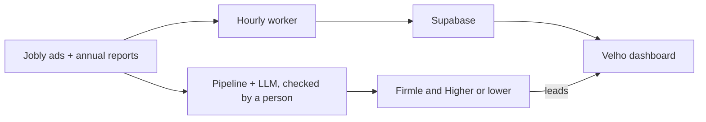

# Firmle

**Guess the firm from its job ads. Spot the work a machine should be doing.**

Prompt Operations Hackathon · Velho challenge · Startup Sauna, Espoo · 24–25 October 2026

## The problem

Cold AI pitches to CEOs get ignored, even though their own job ads show exactly where
routine work slows them down.

## What we built

Firmle is a free daily browser game that turns that public data into marketing for Velho.

- **Firmle:** Wordle for firms. Guess the Finnish company from its real job ads in five
  picks. Each wrong pick unlocks a clue: a quote from an ad, the jobs they're hiring for,
  where they hire, Velho's take, and finally the first letter. The reveal shows how many of
  the company's open ads describe work software could take over, links to a one-page CEO
  brief, and asks "Want this analysis for your company?"
- **Higher or lower:** compare two real companies on revenue, growth, admin costs, time
  holding stock or repetitive work in job ads. Every figure links to its source, and the
  end screen invites players to see how their own company ranks.
- **For Velho:** a marketing dashboard of who is hiring for routine work, the leads the
  games collect, and an outreach desk that drafts emails from the same evidence. Nothing is
  sent without approval.

## How it works, and what's AI about it

- **Data:** a pipeline collects job ads from Jobly and audited annual reports (ESEF
  filings). Missing figures are left out, never invented.
- **Supabase:** the marketing dashboard runs on a Supabase Postgres database. A GitHub
  Actions worker fetches fresh Jobly ads every hour, flags phrases that describe routine
  work and saves them to Supabase, so the dashboard stays current without a redeploy.
- **AI:** an LLM reads the job ads, picks the quotes that show routine work, translates them
  to English and writes Velho's take on each company. Every quote is checked word for word
  against the original ad, and a person reviews it before it ships. All of this runs ahead
  of time, so the live game is fast and never shows an unchecked claim.
- **Funnel:** play daily, then share your result, see Velho's angle in the reveal and leave
  your details. Leads go straight to Velho's dashboard.



## What's next

- Grow from the current cases to a new firm every day.
- Connect leads to Velho's CRM and send each one a brief for their own company.
- Let any company look itself up, not just the ones in the game.

## Run it

```bash
git clone https://github.com/Ja-Jau/prompt-operations-hack.git
cd prompt-operations-hack
npm install
npm run dev
```

| URL | What it is |
|---|---|
| `http://localhost:3000` | Firmle and Higher or lower |
| `http://localhost:3000/velho` | Marketing dashboard (demo login **admin / admin**) |
| `http://localhost:3000/velho/responses` | Invitation responses |
| `http://localhost:3000/outreach` | Outreach desk |
| `http://localhost:3000/brief/<company-id>` | One-page CEO brief |

The games need no API keys. To connect the dashboard to Supabase, copy `.env.example` to
`.env.local`, fill in the variables below and restart `npm run dev`.

## Supabase setup

1. In the Supabase **SQL Editor**, run the
   [dashboard migration](supabase/migrations/202610250001_dashboard_job_ads.sql).
2. Add `SUPABASE_URL` and `SUPABASE_SECRET_KEY` to **GitHub → Settings → Secrets and
   variables → Actions** (for the hourly worker) and to **Vercel → Settings → Environment
   Variables** (for the website). Keep the key server-side: never prefix it with
   `NEXT_PUBLIC_` or commit it.
3. Run **Actions → Refresh dashboard Jobly ads → Run workflow** once, then open `/velho`.

The database uses Row Level Security and grants nothing to browser roles; only the website
server reads it, after the dashboard login. See the [Supabase guide](supabase/README.md)
for details and troubleshooting.

## Environment variables

| Variable | Purpose |
|---|---|
| `SUPABASE_URL`, `SUPABASE_SECRET_KEY` | Dashboard database, for the website and the GitHub Actions worker |
| `DASHBOARD_SESSION_SECRET` | Signing key for dashboard sessions |
| `KV_REST_API_URL`, `KV_REST_API_TOKEN` | Optional Upstash Redis for leads and responses (falls back to `.data/` locally) |
| `NEXT_PUBLIC_VELHO_URL` | Where Velho links point; defaults to `https://velho.io/` |
| `NEXT_PUBLIC_LOGO_DEV_TOKEN` | Optional company logos |
| `ANTHROPIC_API_KEY` | Optional, for the offline AI case-writing pipeline |

## Code map

| Location | What's there |
|---|---|
| `src/components/case/` | Firmle |
| `src/components/game/` | Higher or lower |
| `src/components/dashboard/` | Marketing dashboard, drafts and responses |
| `src/lib/outreach/` | Scoring, email drafts and invitations |
| `pipeline/` | Job-ad import, quote checking, AI case writing, financial metrics, Supabase worker |
| `supabase/migrations/` | Dashboard database schema |
| `src/data/` | Game datasets |

Built with Next.js 16, React 19, TypeScript, Tailwind CSS v4, Python, GitHub Actions and
Supabase.
