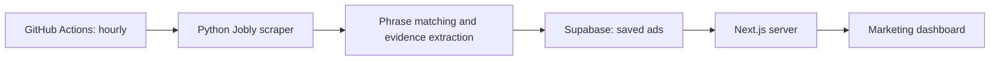

# Firmle

**A daily company-guessing game and a marketing dashboard built around real Finnish job ads.**

Prompt Operations Hackathon · Velho challenge · Startup Sauna, Espoo · 24–25 October 2026

Velho helps companies reduce repetitive work. Job ads provide concrete clues about that
work: entering data, maintaining spreadsheets, processing invoices, and moving information
between systems. Firmle turns those clues into a game people can share. The marketing
dashboard helps Velho review the same kind of signals and prepare conversations with companies.

## What the project includes

| Feature | What it does |
|---|---|
| **Firmle** | Read real job-ad clues and guess the company from nine choices. Five guesses, a daily case, practice cases, hints, and shareable results. |
| **Higher or lower** | Compare sourced company metrics across five rounds or an endless game. Uses the committed dataset. |
| **Marketing dashboard** | Browse companies from saved Jobly ads, review evidence, filter opportunities, and compose invitation emails. |
| **Company responses** | Track interested/declined invitation responses and game-link visits when response storage is available. |
| **Company briefs** | Printable evidence-based notes for companies in the bundled game dataset. |
| **Outreach demo** | Review ranked targets and editable email proposals. Sending is simulated. |

The CEO game prototypes remain in the codebase but are not in the public game navigation.

## Run locally

```bash
git clone https://github.com/Ja-Jau/prompt-operations-hack.git
cd prompt-operations-hack
npm install
npm run dev
```

Open these pages:

| URL | Purpose |
|---|---|
| `http://localhost:3000` | Firmle and Higher or lower |
| `http://localhost:3000/velho` | Marketing dashboard |
| `http://localhost:3000/velho/responses` | Invitation responses |
| `http://localhost:3000/outreach` | Outreach demo |
| `http://localhost:3000/brief/<company-id>` | Brief for a supported company |

Dashboard demo login: **admin / admin**. Sessions last eight hours.
The public games need no API keys. To connect the dashboard to Supabase, copy
`.env.example` to `.env.local` and fill in the two server variables below.
Restart `npm run dev` after changing environment variables.

## How the live dashboard pipeline works



1. **Schedule:** the **Refresh dashboard Jobly ads** GitHub Actions workflow runs hourly
   at minute 17 UTC, or manually through **Actions → Run workflow**. It runs independently
   of website visitors and does not require a Python process on Vercel.
2. **Collect:** `pipeline/sync_dashboard_jobs.py` claims a database refresh lock and calls
   `collect_ads()` in `pipeline/refresh_dashboard_jobs.py`. Each attempt rotates through
   one of twelve Jobly categories and fetches up to ten ads. The underlying source parser
   is `velho-game-data/scraper/jobly.py`.
3. **Flag:** the `TASK` regular expression in `pipeline/refresh_dashboard_jobs.py` looks
   for explicit English and Finnish phrases describing repetitive tasks. A match saves a
   verbatim excerpt of up to 25 words. Ads without a match are saved too.
4. **Store:** the Python worker calls the Supabase function `finish_dashboard_job_refresh`.
   Ads are inserted or updated in `dashboard_job_ads`, keyed by their Jobly URL.
   `dashboard_job_refresh` tracks category rotation, refresh status, and the lock.
   A successful batch and its timestamp are committed together. Failed batches keep the
   last saved data; overlapping workers are prevented.
5. **Display:** `/velho` reads the saved sample through the website server. All sampled
   companies appear, with flagged opportunities first. Companies without matches are
   labelled **Needs review**. **View analysis** shows evidence and saved source-ad links.
   **Flagged only**, search, and other filters narrow the company list.

**Fetch job ads** reads the latest Supabase sample and updates the company list, counts,
and timestamp directly. It clears filters and returns to the first page. It does not
start a new scrape. If Supabase has not changed since the last fetch, the list can stay
identical. Data updates do not require a website redeployment.

Ads not refreshed for 30 days remain stored but are excluded from dashboard rankings.
This is a recent sample, not a complete census or a guarantee that every ad is still open.
Keyword matching can miss differently worded tasks or flag a phrase without understanding
its context; every opportunity needs human review. It is **not an AI assessment**.

## Supabase setup and Vercel deployment

1. In Supabase **SQL Editor**, run the complete
   [dashboard migration](supabase/migrations/202610250001_dashboard_job_ads.sql).
2. Add these values to **GitHub → repository → Settings → Secrets and variables → Actions**:

   ```text
   SUPABASE_URL=https://your-project.supabase.co
   SUPABASE_SECRET_KEY=sb_secret_your_actual_key
   ```

3. Import this repository into Vercel as a **Next.js** project with root directory `./`.
   Add the same two variables to **Vercel → project → Settings → Environment Variables**
   for the deployment environments you use, then deploy or redeploy.
4. In GitHub **Actions → Refresh dashboard Jobly ads → Run workflow**, run the first batch.
   Check the workflow result and the `dashboard_job_ads` table, then open `/velho`.

GitHub secrets configure the background worker; Vercel variables separately configure the
website. Both need the credentials for the same Supabase project. In Vercel, enter the
variable name and value separately: the value must contain only the raw key, without
quotes or `SUPABASE_SECRET_KEY=`. Keep the key server-side; never prefix it with
`NEXT_PUBLIC_` or commit it to Git.

The database uses Row Level Security and grants no access to browser roles. The website
server reads it using the secret key after the dashboard login check. Anyone with the
shared demo login can view the dashboard; this is not individual-account authentication.

See the [detailed Supabase and worker guide](supabase/README.md) for setup, manual worker
execution, scheduling limits, and troubleshooting.

## Email drafts and responses

**Draft email** immediately composes an editable invitation from the company and its evidence.
**Copy email** copies HTML and plain text; **Download HTML** exports the formatted draft.
No email transport is configured. **Send demo** records an event only and sends nothing.

When invitation storage is available, draft links lead to `/respond/<token>`. Contact and
no-thanks choices are saved via POST; game visits are recorded separately. Repeated clicks
do not create duplicate invitations, and recipients can change their preference. The
Responses dashboard polls every five seconds while visible and shows interested and
declined responses; unanswered invitations contribute to the response-rate denominator.

**Responses and invitations are not stored in Supabase.** They use Upstash Redis when
`KV_REST_API_URL` and `KV_REST_API_TOKEN` (or the equivalent
`UPSTASH_REDIS_REST_URL` / `UPSTASH_REDIS_REST_TOKEN`) are configured. Otherwise they use
`.data/invitations.json` for local demos. Leads similarly use Redis or `.data/leads.json`.
Local files are not reliable persistent storage on Vercel.

If response storage fails, composing and exporting the email still works. The contact
button opens Velho directly, the unsupported no-thanks link is omitted, and demo-send
tracking is disabled. Supabase job-ad storage and response storage are separate.

## Game datasets and AI

Firmle uses curated job-ad evidence in `src/data/hiring.json`. The import pipeline checks
quotes against source descriptions before publishing the game dataset. Higher or lower
uses `src/data/game_companies.json` and `src/data/efficiency.json` for sourced metrics.
These bundled datasets are separate from the live Supabase dashboard sample.

The former **Refresh company data** workflow has been removed. Higher or lower has no
scheduled refresh; its dataset changes only when refreshed files are committed and deployed.

```bash
pip install -r pipeline/requirements.txt
python pipeline/import_jobs.py       # Verify quotes and rebuild Firmle data
python pipeline/build_cases.py       # Optional AI-assisted case writing
npm run data:refresh                 # Refresh company discovery and efficiency data
```

The optional Claude-powered scripts prepare case explanations offline. The hourly Jobly
worker and live games do not require an AI API key. See
[pipeline/EFFICIENCY.md](pipeline/EFFICIENCY.md) for metric definitions and coverage.

## Environment variables

| Variable | Purpose |
|---|---|
| `SUPABASE_URL` | Project URL for saved dashboard ads; configure in the web app and GitHub Actions. |
| `SUPABASE_SECRET_KEY` | Raw server secret for dashboard reads and worker writes; configure in both places. |
| `DASHBOARD_SESSION_SECRET` | Deployment-specific signing key for dashboard sessions. |
| `KV_REST_API_URL`, `KV_REST_API_TOKEN` | Optional Upstash storage for invitations, responses, and leads. The `UPSTASH_REDIS_REST_*` aliases are also supported. |
| `NEXT_PUBLIC_VELHO_URL` | Destination for the app's Velho links; defaults to `https://velho.io/`. |
| `NEXT_PUBLIC_LOGO_DEV_TOKEN` | Optional logo.dev token for company logos. |
| `ANTHROPIC_API_KEY` | Optional offline AI case-writing pipeline. |

Without Supabase configuration, the dashboard can display bundled demo data and existing
local samples. **Fetch job ads** asks for configuration rather than starting a local scraper.

## Code map

| Location | Responsibility |
|---|---|
| `src/components/case/` | Firmle game, clues, and reveal |
| `src/components/game/` | Higher or lower |
| `src/components/dashboard/` | Marketing dashboard, drafts, and responses |
| `src/lib/dashboard/job-ads.ts` | Read Supabase samples and group ads by company |
| `src/lib/dashboard/prospects.ts` | Include all companies, rank opportunities, and label unflagged samples |
| `src/lib/outreach/` | Scoring, contact suggestions, email templates, and invitation storage |
| `pipeline/sync_dashboard_jobs.py` | Scheduled worker and Supabase writes |
| `pipeline/refresh_dashboard_jobs.py` | Category rotation, bounded fetching, and task patterns |
| `velho-game-data/scraper/` | Jobly parsing, HTTP fetching, caching, and robots access checks |
| `.github/workflows/refresh-dashboard-jobs.yml` | Hourly worker schedule |
| `supabase/migrations/` | Database schema and refresh functions |
| `src/data/` | Committed game datasets |

## Validation and current limits

```bash
npm run lint
npm run build
npm run test:game
.venv/bin/python tests/dashboard-jobs.test.py
.venv/bin/python tests/dashboard-sync.test.py
```

Python checks require the scraper dependencies in `velho-game-data/requirements.txt`.
The stack is Next.js 16, React 19, TypeScript, Tailwind CSS v4, Python, GitHub Actions,
and Supabase Postgres.

This is a prototype. Contact inboxes can be derived suggestions and require verification.
Emails and proposals need human review. Newly discovered dashboard companies may not have
printable briefs because briefs currently use the bundled game dataset. Demo credentials
are shared, response persistence needs Redis on a hosted deployment, and keyword flags
are a shortlist rather than a company-level judgment.
